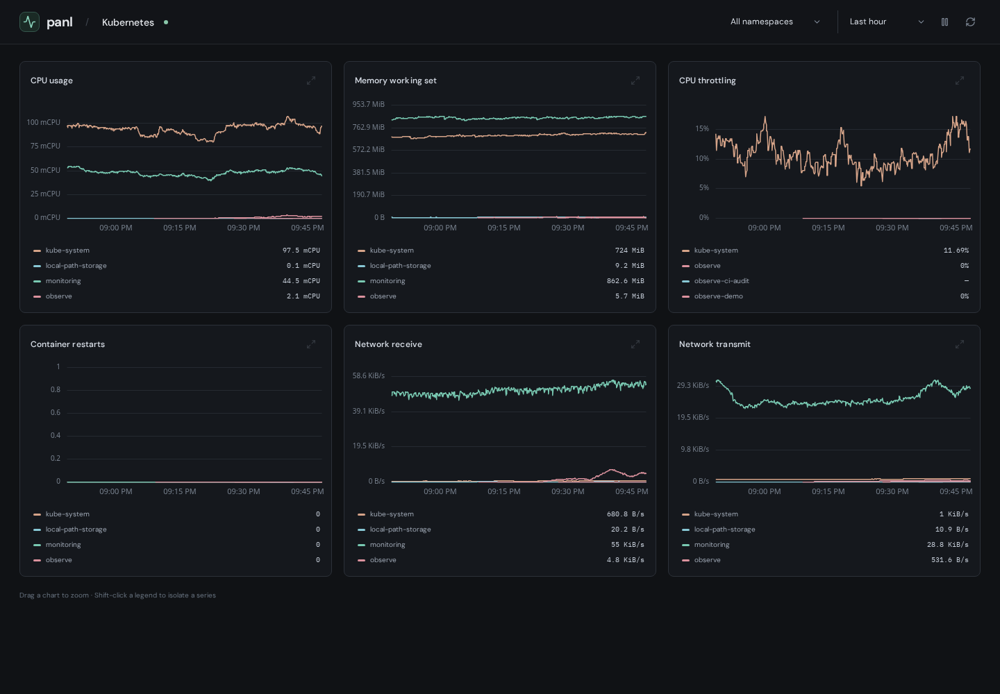

# Panl

**A Kubernetes dashboard viewer that your agent builds and updates.**

PromQL time series, a quiet read-only UI, and an authenticated MCP interface for your existing agent. Discover real metrics, create a dashboard, then refine it through feedback. No embedded model or model API key is required.



## Deploy to Kubernetes

Build an image and install the Helm chart:

```sh
docker build -t YOUR_REGISTRY/panl:0.1.0 .
docker push YOUR_REGISTRY/panl:0.1.0
helm upgrade --install panl ./deploy/helm/panl \
  --namespace panl --create-namespace \
  --set image.repository=YOUR_REGISTRY/panl --set image.tag=0.1.0 \
  --set prometheus.url=http://prometheus-operated.monitoring.svc.cluster.local:9090 \
  --wait
kubectl -n panl port-forward svc/panl 8080:8080
```

Open http://localhost:8080. [Full deployment instructions](docs/kubernetes.md), including persistent storage, Prometheus credentials, Ingress, and a demo that needs no Prometheus.

A public image/chart registry is not published yet; the source build above is the current installation path.

## Ask your agent

Connect your agent to `http://localhost:8080/mcp` with the credential generated by the chart. [Codex and Claude Code setup](docs/agents.md).

> Create a Kubernetes namespace dashboard with CPU and memory. Discover available metrics and validate the queries first.
>
> Split CPU by pod. Add requests and limits as dashed overlays.
>
> Add network traffic and keep the other panels unchanged.

Agents use typed MCP tools to discover metrics, execute PromQL, dry-run definitions, and apply revision-checked edits. The viewer picks up changes automatically. [Verified real-metrics walkthrough](docs/agent-workflow.md).

## Read the charts

- Shared namespace and time controls, synchronized cursors, and drag-to-zoom.
- Stable series colors, explicit units, missing-data gaps, and interactive legends.
- Paused links preserve an exact interval for sharing.
- Background refresh preserves charts and hidden-series selections; failed refreshes label previous data explicitly.
- Read-only browser UI. Dashboard configuration lives in agent tools and the [HTTP API](docs/http-api.md).

The default dashboard covers CPU, memory, throttling, restarts, and network traffic. Additional dashboards are small JSON definitions; see [an example](examples/namespace-resources.json).

## Scope

Time-series panels and one configured Prometheus-compatible endpoint. Single-replica SQLite persistence. Kubernetes resource dashboards depend on available kubelet/cAdvisor and kube-state-metrics data. Agents adapt queries to the actual installation.

Dashboard authoring forms, embedded chat, alert management, Grafana JSON compatibility, arbitrary visualization types, multi-tenant access control, and native histogram rendering are outside this release.

## Develop

React + TypeScript + uPlot; Go + Prometheus's parser/query engine; SQLite. Fonts and frontend assets are self-hosted.

[Build and verification commands](WEB.md). Browser tests use a self-contained demo and do not require a cluster. The Helm deployment has also been tested against kind and real Prometheus, including persistent-volume recovery after a pod restart.

Apache-2.0. See [LICENSE](LICENSE) and [NOTICE](NOTICE). The [launch-readiness report](docs/launch-readiness.md) records remaining publication and independent-user validation work.
